

# Hi there, I'm Eman Mohammad! 👋

### 🚀 Angular Developer & Software Engineer

Informatics Engineer specializing in building robust, performant web applications.
Passionate about the Angular ecosystem, state management, and web performance optimization.

---

## 🛠️ Tech Stack & Skills

**Frontend**

**Backend & Databases**

**Tools & Architecture**

---

## 💼 Work Experience

### 💻 Angular Developer | Phinexes *(Jan 2026 – Present)*
- Leading advanced frontend performance tuning initiatives.
- Architecting adaptive core layout web features.
- Eliminated Cumulative Layout Shift (CLS) and achieved **100% Lighthouse Performance** scores on major production page templates using sequential `@defer` rendering strategies.

### 🏦 Angular Developer | Smart Soft *(Nov 2024 – Present)*
- Developing core banking systems with the Angular framework.
- Integrating services with a Spring Boot backend infrastructure.
- Using Camunda for business process and state-management workflow orchestration.

### 🌐 Angular Developer | OswaTech *(Jun 2022 – Dec 2024)*
- Built clean, responsive interfaces by pixel-perfectly converting Figma and Adobe XD designs into fully modular Angular applications.
- Integrated RESTful APIs and optimized state synchronization pipelines.
- Developed the following major projects:
  - **Izar CRM** (Real Estate Management)
  - **Rayyan Exchange** & Rayyan Exchange Dashboard
  - **Job Website** & Job Dashboard
  - **Sallah Soft** Dashboard
  - **Golden Wheat** Website
  - **Fashion E-Commerce** Website
  - **OswaTech** Corporate Website

### 🔌 Fullstack Developer | Remote (ASP.NET & PHP) *(Dec 2021 – Feb 2022)*
- Developed dynamic end-to-end web architectures using Java, ASP.NET, and Laravel across backend data structures and frontend layers.

---

## 🚀 Highlighted Personal Projects

| Project | Tech Stack | Highlight |
|---|---|---|
| 🛒 **Intelligent E-Commerce Web App** | Laravel, HTML5, CSS3, JavaScript, Bootstrap, MySQL | Custom recommendation algorithm that shows the right products to users based on behavior profiles |
| 🏠 **Smart IoT Home Automation Controller** | C# ASP.NET, Entity Framework, SQL Server, jQuery, Bootstrap, Arduino | Live telemetry rules to control, schedule, and monitor smart-home appliances over web protocols |
| ♟️ **Chess Engine & Game App** | Java Desktop | Standalone interactive chessboard driven by the Minimax AI decision-tree algorithm |

---

## 📸 Featured Project Showcases

> A showcase of production-ready Angular applications, dashboards, and responsive platforms.

### 🏢 OswaTech Corporate Website
*Pixel-perfect corporate identity application*

<!--OSWA_START-->
#### 🖥️ Desktop

<table>
<tr><td width="50%" align="center">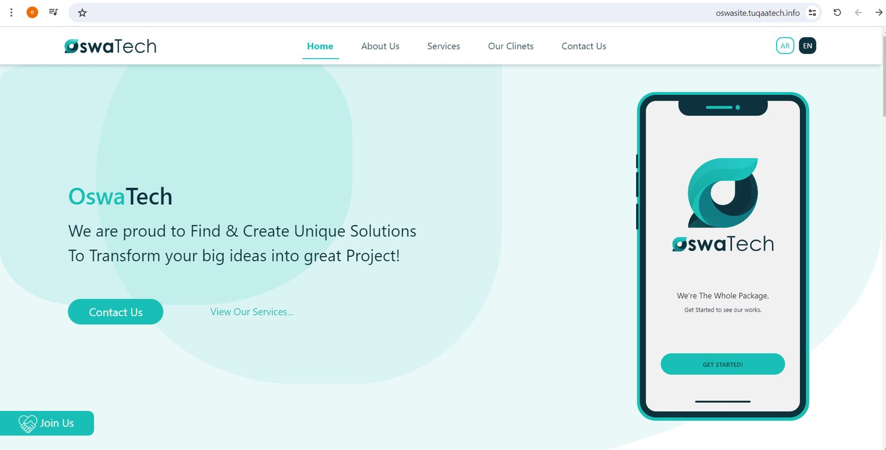 <b>Home – Hero</b></td><td width="50%" align="center">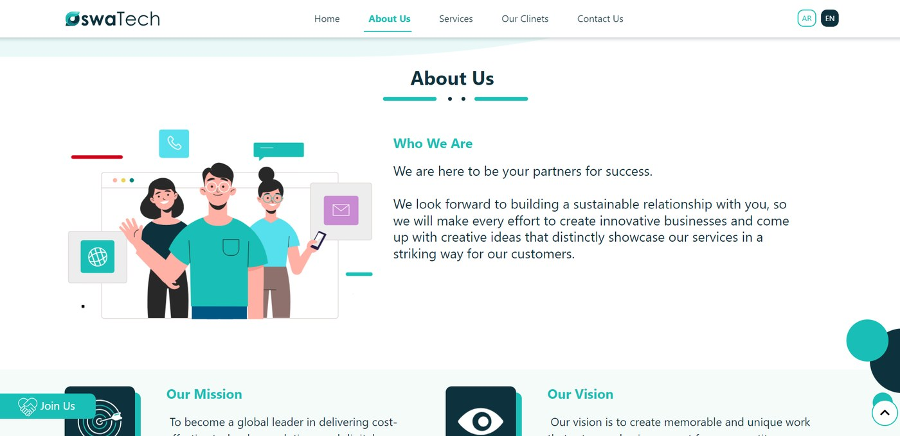 <b>About Us</b></td></tr>
<tr><td width="50%" align="center">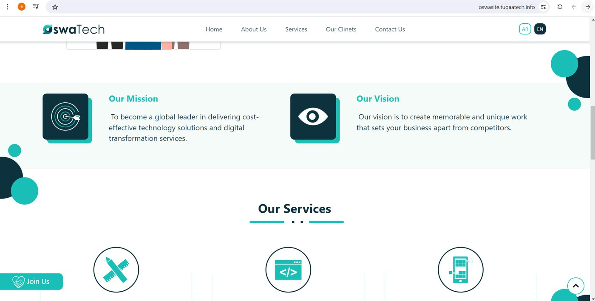 <b>Mission, Vision & Services</b></td><td width="50%" align="center">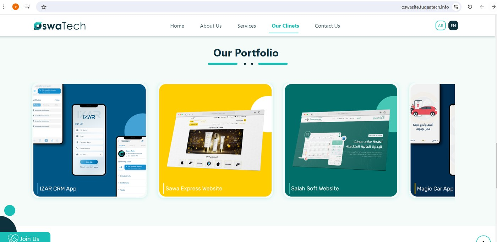 <b>Our Portfolio</b></td></tr>
<tr><td width="50%" align="center">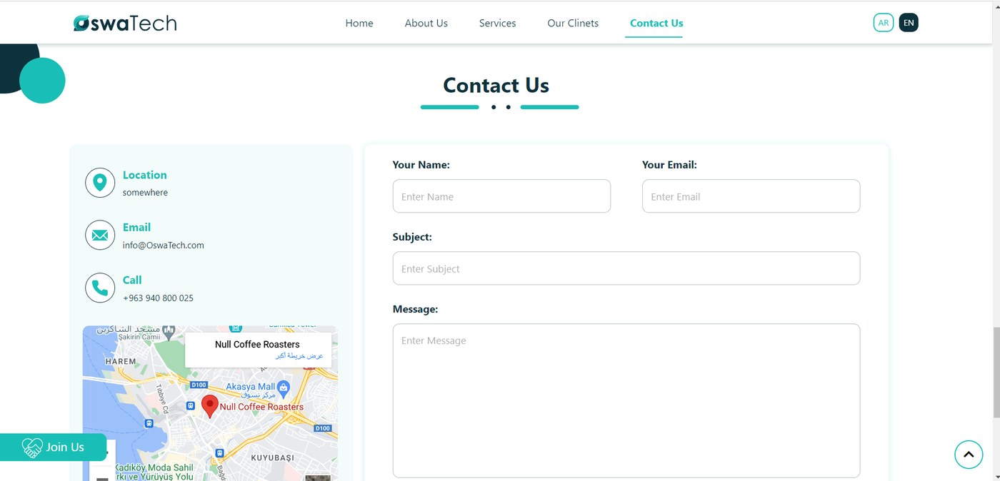 <b>Contact Us</b></td><td width="50%" align="center">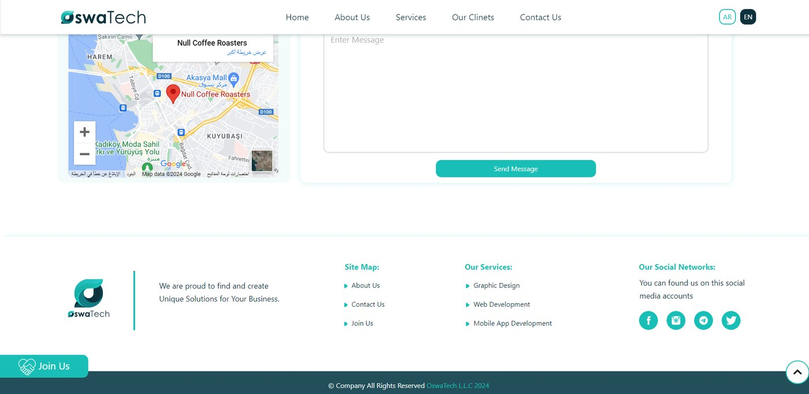 <b>Map & Footer</b></td></tr>
</table>

#### 📱 Mobile (fully responsive)

<table>
<tr><td width="25%" align="center">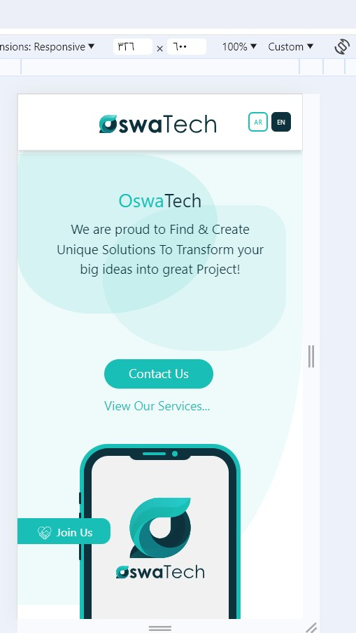 Home</td><td width="25%" align="center">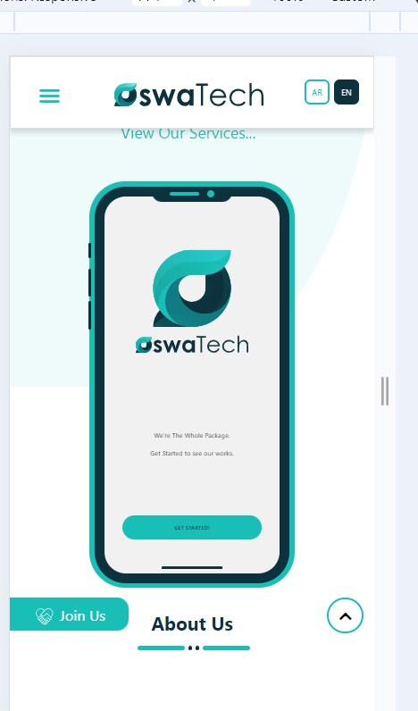 Hero App Preview</td><td width="25%" align="center">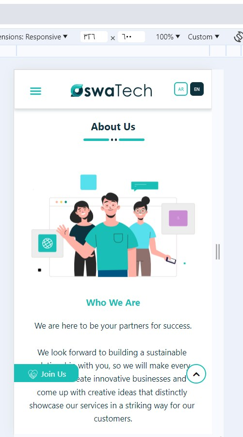 About Us</td><td width="25%" align="center">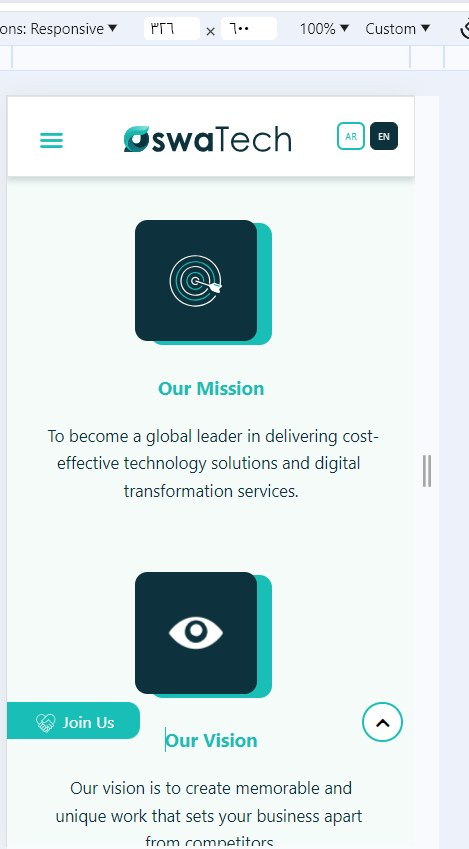 Mission & Vision</td></tr>
<tr><td width="25%" align="center">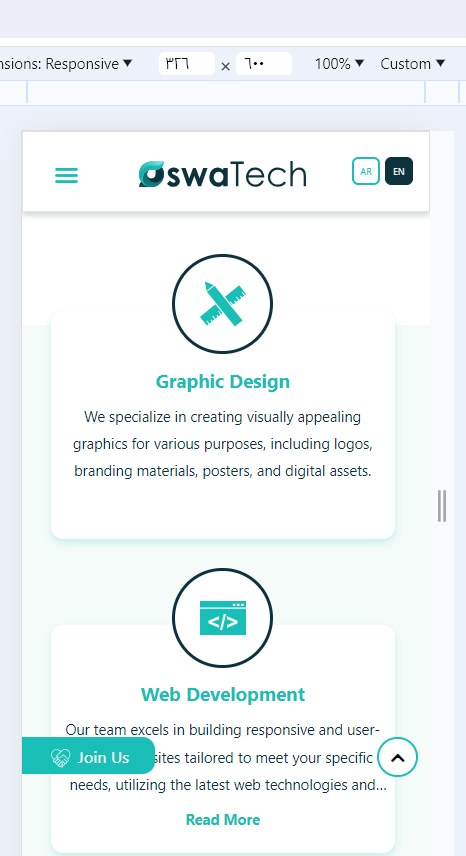 Services</td><td width="25%" align="center">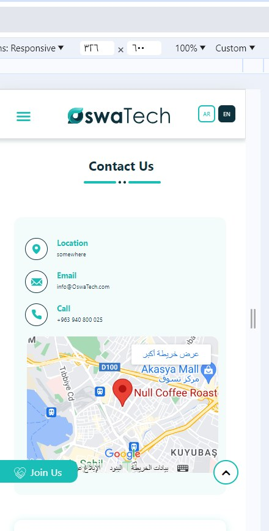 Contact</td><td width="25%" align="center">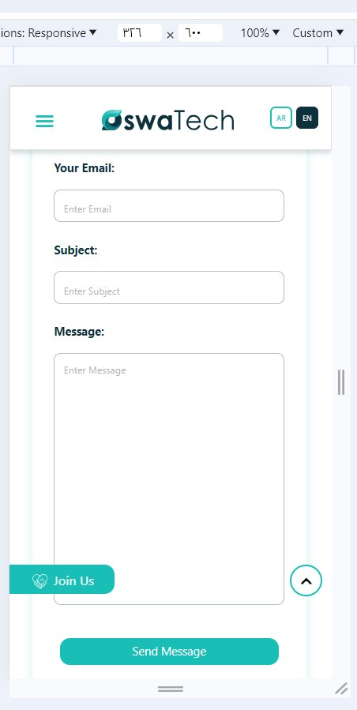 Contact Form</td><td width="25%" align="center">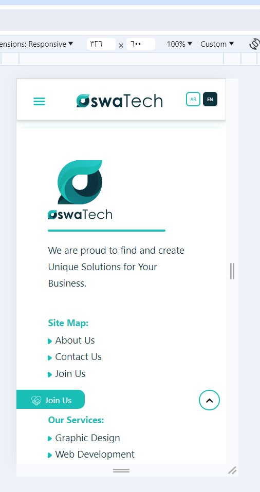 Footer</td></tr>
</table>
<!--OSWA_END-->

### 💼 Marmaz Job – Job Recruitment Platform
*Bilingual (Arabic RTL / English) recruitment platform for job seekers and companies*

<!--JOB_START-->
#### 🖥️ Desktop (Arabic RTL + English)

<table>
<tr><td width="50%" align="center">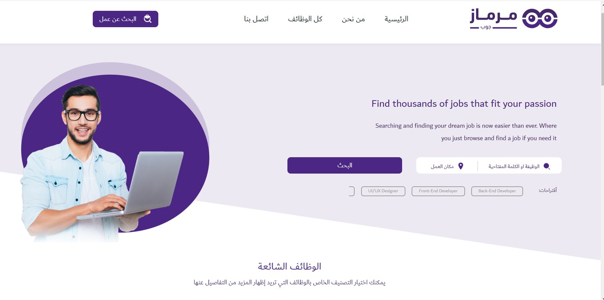 <b>Home & Job Search</b></td><td width="50%" align="center">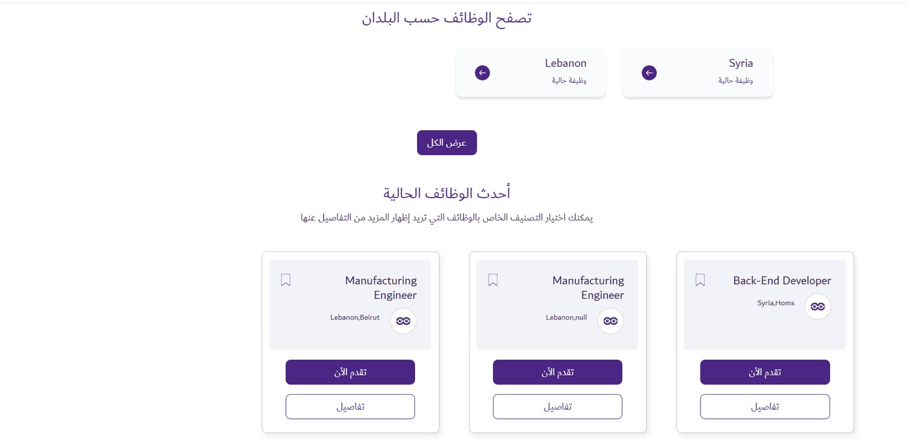 <b>Browse by Country & Latest Jobs</b></td></tr>
<tr><td width="50%" align="center">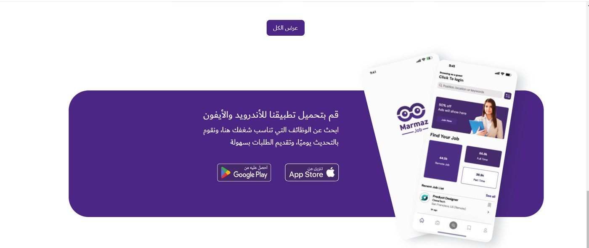 <b>Mobile App Section</b></td><td width="50%" align="center">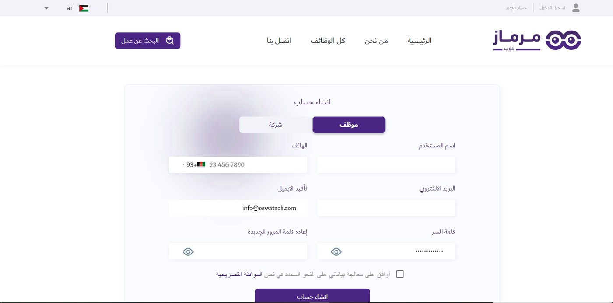 <b>Registration (Employee / Company)</b></td></tr>
<tr><td width="50%" align="center">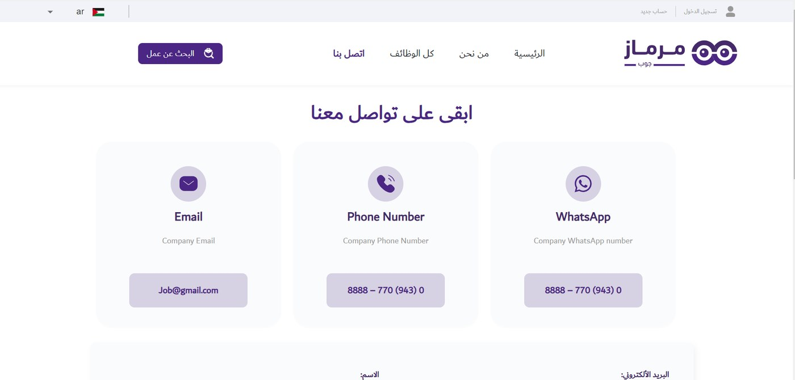 <b>Contact Page</b></td></tr>
</table>

#### 📱 Mobile

<table>
<tr><td width="25%" align="center">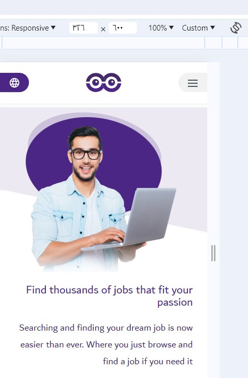 Home</td></tr>
</table>
<!--JOB_END-->

---

## 🎓 Education & Credentials

- **Bachelor’s Degree in Informatics Engineering** — Specialization: Software Engineering
  Damascus University *(Jan 2016 – Dec 2021)* · Grade: 72%
- **C++ and Core Java Desktop Architectures** — Damascus University *(July 2022)*

---

## 📈 GitHub Analytics

---

## 📫 Let's Connect!

- 📧 **Email:** [eman98.eng@gmail.com](mailto:eman98.eng@gmail.com)
- 📍 **Location:** Damascus, Syria
- 🌐 **Languages:** Arabic (Native) · English (Professional Working)
